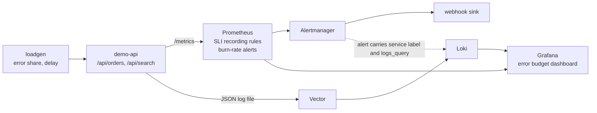
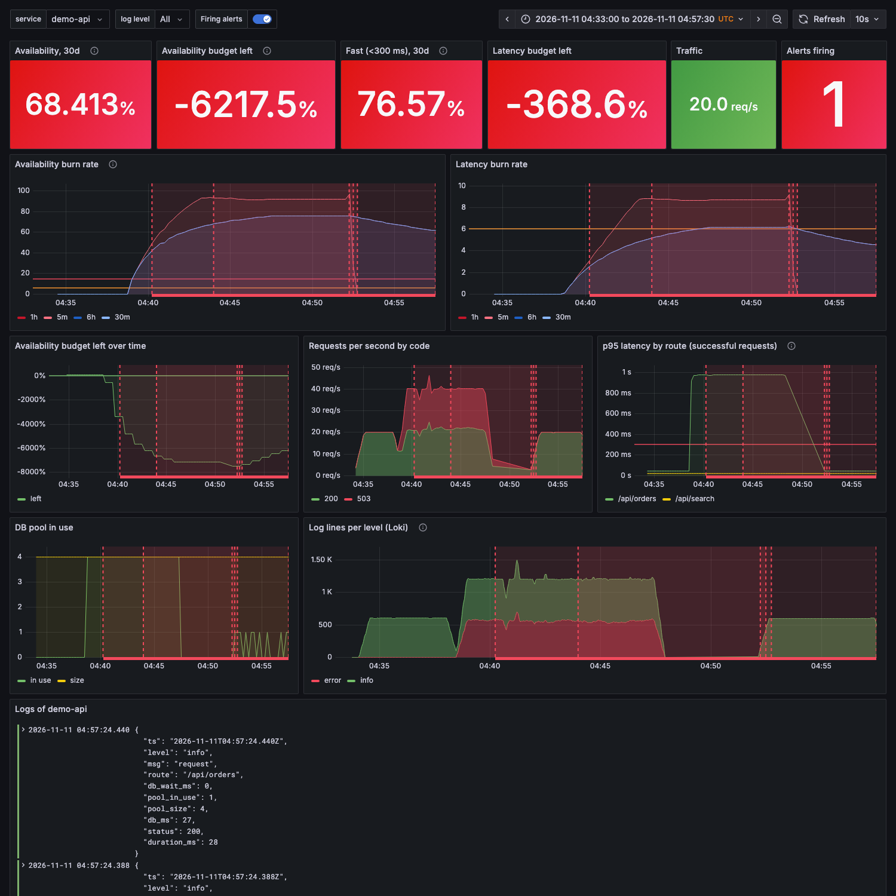

# sre-slo-observability

[](https://github.com/Walaskien/sre-slo-observability/actions/workflows/ci.yml)

SLOs and burn-rate alerts for a small HTTP service, on a Docker Compose stack you can run on a
laptop: Prometheus, Alertmanager, Grafana, Loki and Vector, plus the service and a load generator
that can break it on purpose.

## The problem

"Page when 5xx is above 1% for five minutes" has two bad habits. A thirty second blip pages someone,
and a steady 0.8% that eats the monthly budget over two weeks never does. Both come from alerting on
a rate when the thing that matters is how fast the error budget is being spent.

This repo does it the way chapter 5 of the Google SRE Workbook describes: define the SLI, set an SLO,
and alert on burn rate with two windows that both have to be over the line. The long window says the
damage is real; the short one says it is still going on, so the page clears soon after the problem
does. Then it goes one step further than the book usually does on paper: there is a service to break,
an alert that fires, a link from the alert to the logs of the service behind it, a runbook, and a
postmortem of a drill that was run on the stack.

## How it fits together



`service="demo-api"` is set on the Prometheus scrape target and on the Loki stream, so the label on
an alert is also the selector for its logs. The alert annotation `logs_query` has the LogQL ready.

| Alert | Fires when | Goes to |
|---|---|---|
| `SLOAvailabilityFastBurn` | 5xx ratio over 7.2% for 1h and 5m (14.4x the 0.5% budget) | page |
| `SLOAvailabilitySlowBurn` | over 3% for 6h and 30m (6x) | ticket |
| `SLOLatencyFastBurn` / `SLOLatencySlowBurn` | over 72% / 30% of successful requests slower than 300 ms, same windows | page / ticket |
| `ServiceDown` | Prometheus cannot scrape the service for a minute | page |

SLOs: 99.5% of requests are not 5xx, and 95% of successful requests take 300 ms or less, both over
30 days. The definitions, the arithmetic and the cases that are not covered are in
[docs/slo.md](docs/slo.md).

## Quick start

Needs Docker with Compose v2 and `make`. Ports are bound to localhost and can be moved with
`GRAFANA_PORT`, `PROMETHEUS_PORT`, `ALERTMANAGER_PORT`, `LOKI_PORT`, `APP_PORT`.

```console
make up              # build the service, start the stack
make baseline        # 20 req/s of healthy traffic for 5 minutes
make slow-queries    # second terminal: 40 req/s, every /api/orders holds its DB connection 400 ms longer
make alerts          # what Alertmanager holds right now
make logs            # the latest error lines from Loki
make down            # stop and remove everything, volumes included
```

`make errors` is the simpler failure: a third of the requests return 500.

Grafana is on http://localhost:3000, dashboard "SLO and error budget" (anonymous viewer; the demo
admin password is `admin`). Alert links in the annotations assume that port.

Expect the page about two minutes after `make slow-queries` starts. The long windows are short on a
fresh stack (they only hold what has happened since `make up`), which is why it is that quick; see
the postmortem for the real timings.

What the drill looks like on the dashboard (baseline, 04:38 incident, recovery; the flat stretch
before 04:52 is when no load was running):



## The drill

[docs/postmortems/2026-11-11-db-pool-exhaustion.md](docs/postmortems/2026-11-11-db-pool-exhaustion.md)
is a postmortem of the `make slow-queries` run on this stack. Short version: the pool of 4 connections
could serve about 9 orders per second, 28 arrived, the rest got 503 "db pool exhausted". The page
reached the webhook 1 min 50 s after the first bad request. The alert's own `logs_query` led to the
error lines, and the `db_ms` field showed connections held 16 times longer than before. The cause was
injected by me, which the write-up says up front.

## Verified

Run on macOS with Colima (Docker 29), Python 3.9.6, 2026-11-10 and 2026-11-11.

| Check | Result |
|---|---|
| `pytest -q` (service, load generator, webhook sink, config cross-checks) | 28 passed |
| `ruff check .` | all checks passed |
| `promtool check config`, `check rules` | success, 16 rules (11 recording, 5 alerts) |
| `promtool test rules prometheus/tests.yml` | success, 7 scenarios: not burning, no 5xx series yet, fast burn, page resolves after recovery, slow burn, latency burn with 5xx noise, scrape target gone |
| The tests catch breakage | three broken copies of the rules (no short window on the fast alert, no `or 0 *` fallback, 5xx counted in the latency ratio) each failed `promtool test rules` |
| `amtool check-config`, `amtool config routes test` | valid; `severity=page` goes to `page`, `severity=ticket` and no severity to `ticket` |
| `actionlint` on the workflow, `shellcheck` on `scripts/smoke.sh` | clean |
| `docker-compose config -q` | valid (Compose v1.29 in a venv; CI uses `docker compose`) |
| `scripts/smoke.sh`, whole stack, ports moved | passed: all four services ready, dashboard provisioned, 600 requests with 20% failing (120 5xx), `service:sli_errors:ratio_rate5m` above zero, error lines found in Loki under `service="demo-api"`, stack removed |
| The drill, live | fast burn pending 04:39:04, firing 04:40:04, page at the sink 04:40:17; slow availability alert fired and was held back by the inhibit rule until the page resolved; 21600 requests sent, 10018 answered 503, all on `/api/orders` |
| Alert to logs by label | `logs_query` copied from the alert returned the error lines from Loki |
| Dashboard | provisioned from JSON (found through the Grafana API), rendered in headless Chrome, screenshot above |

Not verified:

- GitHub Actions has not run yet: every command in the workflow was run locally, except that
  `docker compose` (v2) was replaced by `docker-compose` (v1.29) and `pytest` ran on 3.9 only.
- How long recovery takes in real time. The recovery half of the live run is not clean (load was
  restarted five minutes late), so only the unit test speaks for resolve behaviour.
- The time to page with a full clean hour of history. The formula in [docs/slo.md](docs/slo.md)
  says about 9 minutes for the drill's error ratio; I did not run it for an hour.
- Anything with real users or real traffic. Every number here comes from a load generator.

## Limitations

- The SLI is measured inside the service. A dead load balancer, DNS or TLS problem would not show.
- Only the first two rows of the Workbook table are implemented. A steady error ratio between 0.5% and
  3% trips nothing, and the 1x / 3 day ticket alert is left out because three days cannot be shown on
  a laptop stand.
- The slow alerts are tickets, where the Workbook pages on the 6x one. One label in `slo.yml`.
- Burn-rate alerts say nothing when there is no traffic (0/0 is empty). `ServiceDown` covers a dead
  process, not a live one that receives nothing.
- On a fresh stack the 1h, 6h and 30d windows only hold the minutes since start. The "budget left"
  stat can read -6000% after one short incident; that is what a 30 day window with 20 minutes in it
  looks like.
- In the drill the fast latency page never fired although orders took a second: slow requests were
  44% of the successful ones and that alert needs 72%. See the postmortem.
- The load generator's fault knobs (`delay_ms`, `fail`) are query parameters, honoured only when the
  service runs with `FAULTS_ENABLED=1`, which the Compose file sets. Do not copy that.
- Alertmanager delivers to a local webhook sink, no real notification channel. Credentials in this
  repo (Grafana admin) are demo values. Logs go to a file on a shared volume and are not rotated.
- Rule evaluation uses 15 s and scrape 5 s so the demo reacts quickly; the usual values are 15 to 30 s
  for scrape.

## Layout

```
app/                    service (server.py), load generator (loadgen.py), webhook sink (sink.py), Dockerfile
prometheus/rules/       slo.yml: SLI recording rules and the burn-rate alerts
prometheus/tests.yml    promtool unit tests
prometheus/prometheus.yml
alertmanager/           routing (page, ticket), inhibit rule
loki/, vector/          log storage and the shipper
grafana/                datasource and dashboard provisioning, dashboard JSON
docs/slo.md             SLIs, SLOs, burn-rate arithmetic
docs/runbook.md         symptom, check, action per alert
docs/postmortem-template.md, docs/postmortems/   template and the drill write-up
scripts/smoke.sh        end-to-end check used by `make smoke` and CI
tests/                  pytest
```

`make check` runs the promtool and amtool checks, `make test` pytest, `make lint` ruff, `make smoke`
the whole stack. CI runs the same.

## Related

[queue-saturation-observability](https://github.com/Walaskien/queue-saturation-observability):
the other side of the same habit. It watches a queue that falls behind while host graphs stay green,
and tells a processing bottleneck from host saturation.
