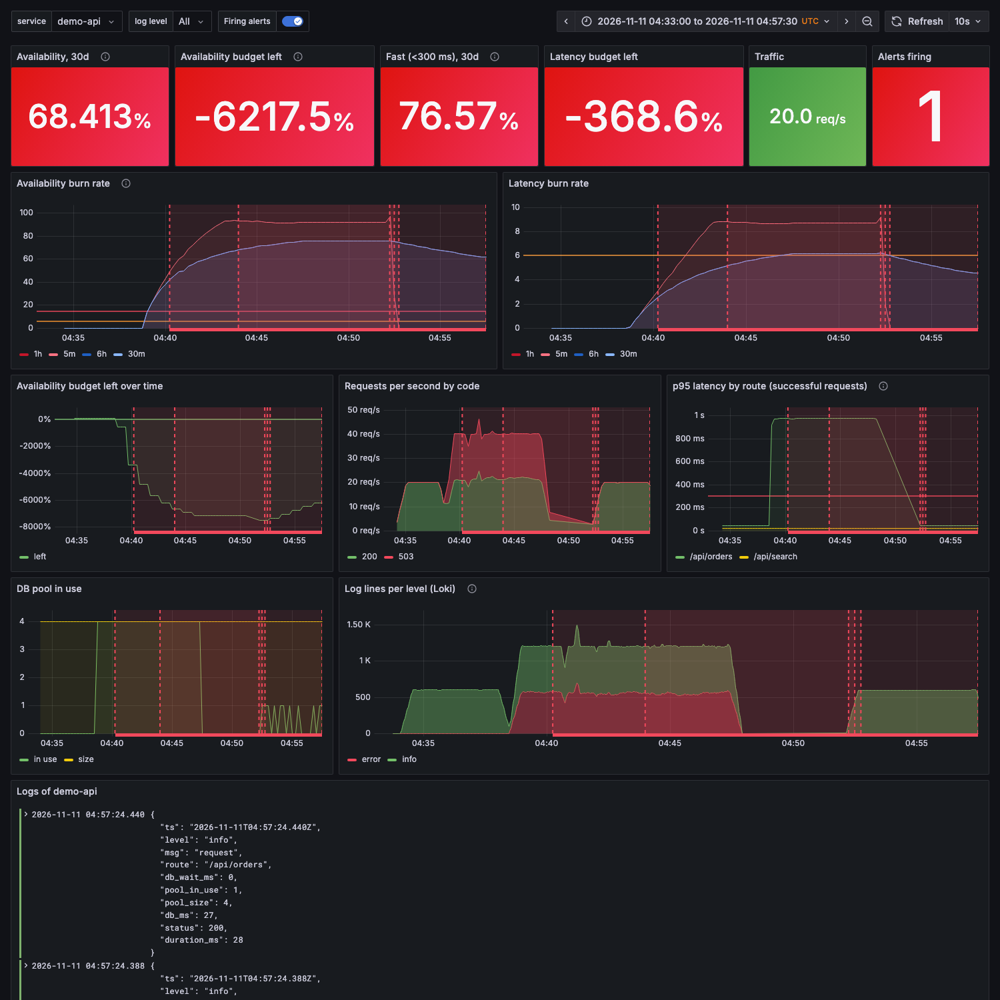

# Postmortem: /api/orders fails with "db pool exhausted" (training incident)

Date: 2026-11-11. Status: draft. Author: Stanislav Petnichenko.

This is a drill, not a real outage. I started it myself on the local Compose stack with the
load generator (`--delay-ms 400`), so I knew where the answer was. What this write-up does test is
whether the alert, its labels and the logs lead there without that knowledge. Everything below is
copied from the run; nothing is rounded up. The stack was a few minutes old, so the 1h, 6h and 30d
windows held only the data from this session (see the caveat under Detection).

## Summary

At 04:38:26 UTC the load generator went from 20 to 40 requests per second and made every
`/api/orders` call hold its database connection 400 ms longer. The pool has 4 connections, so it
could serve about 9 orders per second while 28 arrived. The rest waited 250 ms for a free
connection, gave up, and got a 503. `/api/search`, which does not use the pool, was not affected.
`SLOAvailabilityFastBurn` fired at 04:40:04 and the page reached the webhook sink at 04:40:17.
The load stopped at 04:47:26.

## Impact

- 21600 requests sent in 9 minutes, 11582 answered 2xx, 10018 answered 503 (46%). All 503s were on
  `/api/orders`; `/api/search` had none.
- 5m error ratio sat around 0.46 once the incident was established, about 90 times the 0.005
  budget. The dashboard peaked near 93x.
- Latency: p95 of successful `/api/orders` requests was 975 ms in the one-minute window (the
  300 ms target is the red line on the panel); `/api/search` stayed at 24 ms.
- Budget: the 30 day window only contained this session, so the panel read about -6200% (error
  ratio 0.316 over the data that existed). That number shows the budget is gone; it does not
  mean what it would mean after a real month of traffic.

## Timeline (UTC, 2026-11-11)

| Time | Event |
|---|---|
| 04:34:02 | Stack up, baseline 20 req/s for 240 s: 4800 requests, all 2xx, client p95 35 to 37 ms per 30 s interval |
| 04:38:26 | Incident load starts: `--rps 40 --delay-ms 400` |
| 04:38:27.753 | First error line in Loki: `db pool exhausted`, `db_wait_ms` 251, `pool_in_use` 4 of 4 |
| 04:38:49 | `SLOAvailabilitySlowBurn` pending |
| 04:39:04 | `SLOAvailabilityFastBurn` pending |
| 04:40:04 | `SLOAvailabilityFastBurn` firing (Alertmanager `startsAt`) |
| 04:40:17 | Page delivered to the webhook sink |
| 04:43:49 | `SLOAvailabilitySlowBurn` firing, held back by the inhibit rule (state `suppressed`) |
| 04:47:26 | Incident load ends |
| 04:47:30 to 04:52:00 | No traffic: my session was interrupted and I started the recovery load late. My poller also logged nothing for 280 s here |
| 04:52:04 | `SLOLatencySlowBurn` firing (ticket delivered 04:52:15); healthy 20 req/s traffic restarted at 04:52:06 |
| 04:52:45 | `SLOAvailabilityFastBurn` resolved notification delivered |
| 04:53:15 | `SLOLatencySlowBurn` resolved |
| 04:53:30 | `SLOAvailabilitySlowBurn` ticket delivered, now that the fast alert no longer inhibits it |
| 04:56 | I stopped watching; the slow availability ticket was still firing (30m window still over 3%) |

I cannot say how long recovery takes in real time: the windows sat on stale data for almost five
minutes with no traffic, so the resolve times above do not measure a recovery. `prometheus/tests.yml`
covers the resolve behaviour ("page resolves after recovery"); the live run does not.

## Detection

`SLOAvailabilityFastBurn` was the first and only page. 1 min 50 s passed between the first bad
request (04:38:27) and the delivered page (04:40:17); the pending state started 37 s after the first
error.

That is quick because the stack was young: the 1h window held about five minutes of data, so the
7.2% line was crossed almost at once. With a clean hour behind it, the formula in
[slo.md](../slo.md) gives about 4.3 / 0.46 = 9 minutes for this error ratio. I did not test that.

The alert carried what was needed: `service="demo-api"`, a `logs_query` annotation with the same
label, and the dashboard link. The inhibit rule worked as intended: the slow availability alert
was `suppressed` while the page was active and reached the sink only after the page resolved.

Two things I did not like:

- Orders were slow for the whole incident (p95 975 ms) and no latency page fired. Slow requests
  were about 44% of successful ones, below the 72% that the fast latency alert needs. The slow
  latency ticket fired only at 04:52:04, hovered at its 30% line and cleared a minute later.
- A page for "most requests fail" and silence for "the requests that work take a second" is the
  expected behaviour of these thresholds, but it is worth knowing before relying on them.

## Root cause

Steps, with the evidence for each. All queries were run in Loki and Prometheus on the stack.

1. The alert's `logs_query` verbatim, `{service="demo-api", level="error"}`, returned error lines
   right away. Counted at 04:58: 10012 lines in Loki, all of them `msg="db pool exhausted"` on route
   `/api/orders`. Prometheus and the load generator counted 10018 503s; I did not chase the
   difference of six.
2. Every error line has `pool_in_use` 4 and `pool_size` 4, and an average `db_wait_ms` of 250: the
   requests used the whole acquire timeout and found no free connection. The first one, 1.3 s
   after the load started:
   `{"ts":"2026-11-11T04:38:27.753Z","level":"error","msg":"db pool exhausted","route":"/api/orders","db_wait_ms":251,"pool_in_use":4,"pool_size":4,"error":"no free connection before timeout","status":503,"duration_ms":251}`
3. So something holds connections too long. In the successful `/api/orders` lines `db_ms` averaged
   426 ms (max 437) in the two minutes up to 04:42:30, against an average of 27 ms (max 78) in the
   four minutes before the load changed. Connections were held about 16 times longer.
4. The numbers close: 4 connections / 0.426 s is about 9.4 orders per second. Prometheus, one
   minute window: 9.4 successful and 18.5 failed `/api/orders` per second, 27.9 in total, which is
   the 28 per second that arrive (40 req/s, 70% of them orders).

Trigger and cause are different things here. The trigger was the 400 ms added to every orders query
(my `--delay-ms`, standing in for a slow query or a slow downstream call). The reason it turned
into errors is that the service has no slack for it: 28 orders per second on a pool of 4 is stable
only while a query takes under 4 / 28 = 143 ms, and when it does not, the queue is bounded only by
the 250 ms acquire timeout, so requests fail instead of slowing down gradually.

## What went well, what did not, where we were lucky

Went well: a page within two minutes; the shared `service` label took me from the alert to the logs
in one step; the logs named the resource (the pool) and the route; the ticket stayed quiet during the page.

Did not: no signal for pool wait time in the metrics (`db_pool_in_use` shows 4 of 4 but not how
long requests wait), the latency alert gap above, and the recovery half of this run is not clean (see the gap in the timeline).

Lucky: nothing; the cause was injected by me. That is the main limit of this exercise.

## Action items

None of these is done; this is a demo repository.

| Action | Type | Owner | Ticket / due |
|---|---|---|---|
| Add a `db_pool_wait_seconds` histogram so saturation is visible before it becomes 503s | detect | repo owner | not scheduled |
| Decide whether a page is wanted when most of the *successful* requests are slow but few fail (lower the fast latency threshold, or add a p95 alert) | detect | repo owner | not scheduled |
| Re-run the drill with an hour of clean traffic first, and compare the real time to page with the ~9 minute estimate | verify | repo owner | not scheduled |
| Real service: cap the work per request (statement timeout) and shed load before the pool is empty | prevent | service owner | n/a |

## Appendix

Load commands (`make baseline`, `make slow-queries`, run with other host ports):

```console
docker-compose run --rm loadgen --rps 20 --duration 240
docker-compose run --rm loadgen --rps 40 --duration 540 --delay-ms 400
```

Queries used above:

```
# Loki
{service="demo-api", level="error"}
sum by (msg, route) (count_over_time({service="demo-api", level="error"} | json [5m]))
avg_over_time({service="demo-api", level="info"} | json | route="/api/orders" | unwrap db_ms [2m]) by (route)

# Prometheus
sum by (route, code) (rate(http_requests_total[1m]))
histogram_quantile(0.95, sum by (le, route) (rate(http_request_duration_seconds_bucket{code!~"5.."}[1m])))
db_pool_in_use / db_pool_size
```

Dashboard over the whole run (traffic is flat zero between 04:47:30 and 04:52):


